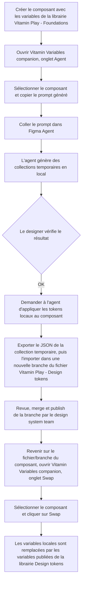

# Process de création des variables de composants

Ce document décrit le workflow à suivre pour créer, tester et publier les variables (tokens) d'un composant Figma à l'aide du plugin **Vitamin Variables companion**.

## Vue d'ensemble

## Étapes détaillées

### 1. Création du composant
Le designer construit le composant dans Figma en utilisant les variables de la librairie **"Vitamin Play - Design Tokens"** (couleurs, spacing, radius, typographie, etc.).

### 2. Génération du prompt (onglet Agent)
Une fois le composant terminé :
1. Ouvrir le plugin **Vitamin Variables companion**.
2. Aller dans l'onglet **Agent**.
3. Sélectionner le composant sur le canvas.
4. Copier le prompt affiché (bouton de copie).

### 3. Exécution dans Figma Agent
Coller le prompt copié dans **Figma Agent**. L'agent analyse le composant et génère des **collections de variables temporaires en local** (préfixées/nommées comme telles pour les distinguer des collections publiées).

### 4. Vérification
Le designer vérifie que les tokens temporaires générés correspondent bien aux intentions du composant (bonnes valeurs, bon nommage, bonne structure).

### 5. Application des tokens locaux
Si la vérification est concluante, le designer demande à l'agent d'**appliquer les tokens locaux** au composant (rebind des variables du composant vers la collection temporaire locale).

### 6. Transfert vers le fichier Design Tokens
1. Dans le fichier du composant, ouvrir le plugin **Vitamin Variables companion**, onglet **Swap**.
2. Dans **Transfer design tokens**, sélectionner la collection temporaire locale puis copier le JSON affiché.
3. Ouvrir une **nouvelle branche** du fichier **"Vitamin Play - Design tokens"** et rouvrir le plugin.
4. Dans **Transfer design tokens**, sélectionner la collection locale cible, coller le JSON puis cliquer sur **Add tokens to selected collection**.

L'import ajoute uniquement les tokens absents : les tokens déjà présents dans la collection cible ne sont pas remplacés. Les alias vers des variables publiées sont conservés.

### 7. Revue et publication
La branche est revue par l'équipe design system, puis mergée et **publiée** dans la librairie "Vitamin Play - Design tokens".

### 8. Swap des variables (onglet Swap)
Retour sur le fichier/branche contenant le composant :
1. Ouvrir le plugin **Vitamin Variables companion**, onglet **Swap**.
2. Sélectionner la collection source (la collection temporaire locale utilisée à l'étape 5).
3. Sélectionner le composant.
4. Cliquer sur **Swap**.

Cette action remplace les liaisons de variables locales du composant par les variables équivalentes désormais publiées dans la librairie **"Design tokens"**.

## Résultat final
Le composant utilise exclusivement des variables publiées de la librairie **"Vitamin Play - Design tokens"**, sans dépendance à des collections temporaires locales.
